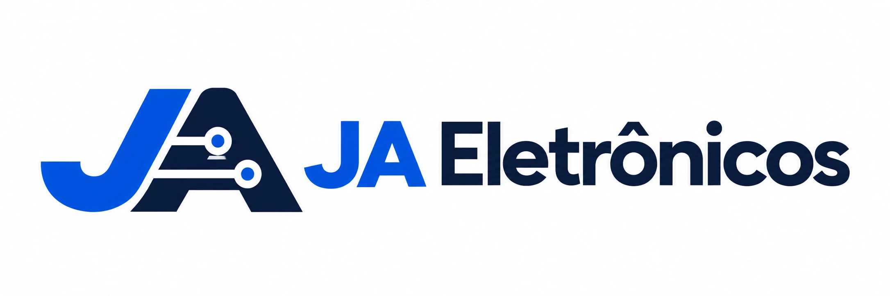
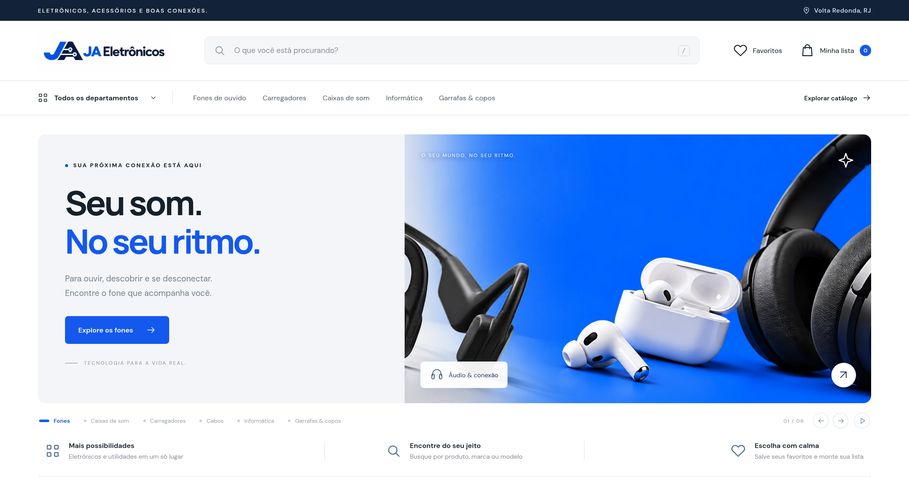
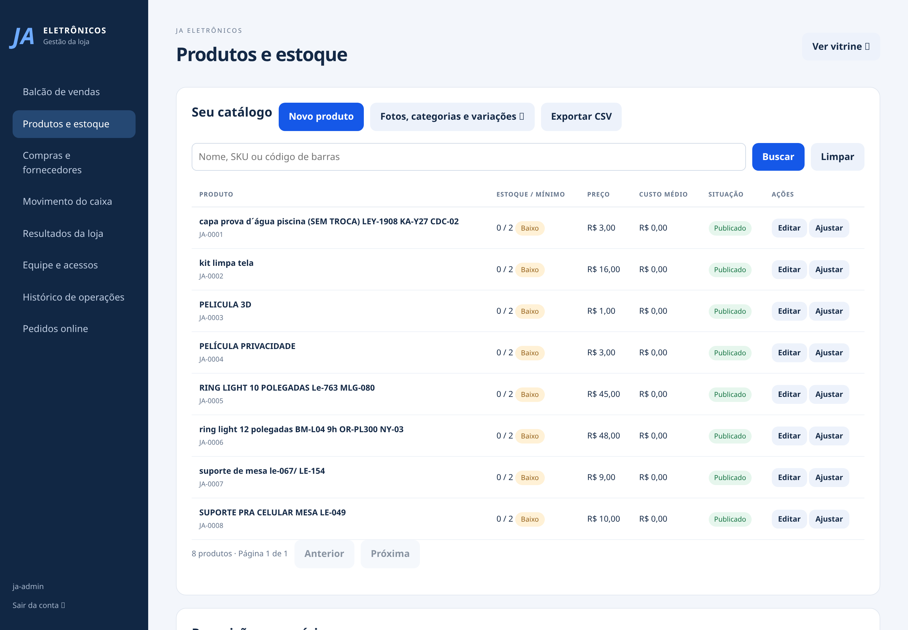
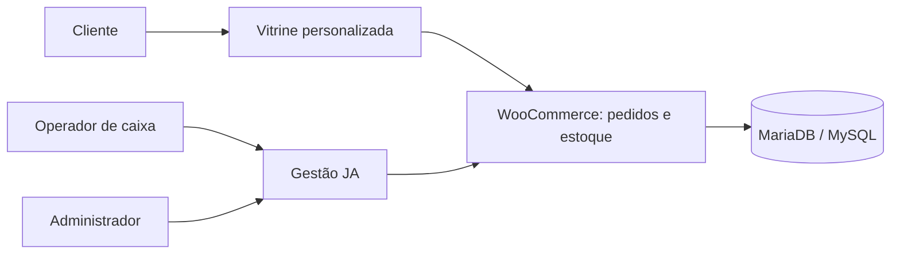

<p align="center"></p>

# JA Eletrônicos

**Uma loja com identidade própria. Um estoque compartilhado entre o site e o balcão.**



Vitrine, checkout e gestão para uma loja de eletrônicos, construídos sobre WordPress e WooCommerce com tema e plugin próprios. O painel reúne caixa, produtos, compras, fornecedores, equipe e relatórios. Os pedidos presenciais e online usam o mesmo catálogo e estoque do WooCommerce.

`WordPress` · `WooCommerce` · `PHP 8.1+` · `JavaScript` · `MariaDB` · `Docker Compose`

## Conheça as telas

| Vitrine no celular | Produtos e estoque |
| --- | --- |
|  |  |

[Caixa](docs/screenshots/cashier.png) · [Compras e fornecedores](docs/screenshots/purchases.png) · [Relatórios](docs/screenshots/reports.png) · [Equipe](docs/screenshots/team.png) · [Pedidos online](docs/screenshots/orders.png)

Capturas da aplicação em ambiente local.

## Funcionalidades

| Área | O que está implementado |
| --- | --- |
| Loja | Design responsivo, seis campanhas no carrossel, categorias, pesquisa, filtros, favoritos, lista de produtos, carrinho e checkout WooCommerce. |
| Caixa | Abertura por operador, venda por SKU/código de barras, troco, sangria, reforço, fechamento e comprovante não fiscal. |
| Estoque | Saldo compartilhado, mínimos, contagem, entradas, perdas e proteção das unidades reservadas. |
| Compras | Fornecedores, pedidos de compra, recebimento e custo médio. |
| Gestão | Pedidos online, devolução integral de vendas presenciais, vendas/custos/margem e exportação CSV. |
| Equipe | Acesso individual, permissões no servidor, criação/desativação de funcionários e histórico das operações do painel. |

O administrador tem acesso à gestão. O operador de caixa vê seu caixa e suas vendas. A aplicação exige conexão; não há modo offline.

## Executar no computador

Você precisa de Python 3 e Docker Desktop com contêineres Linux, ou Docker Engine com Compose no Linux. Os serviços ficam acessíveis somente em `localhost`.

Na raiz do repositório:

```sh
python scripts/prepare-local.py
```

Esse comando baixa dependências oficiais com verificação SHA-256 e prepara os arquivos locais. A primeira execução precisa de internet. Depois:

**Windows (PowerShell):**

```powershell
cd local
powershell -ExecutionPolicy Bypass -File .\abrir.ps1
```

**macOS / Linux:**

```sh
cd local
bash abrir.sh
```

| Endereço | Serviço |
| --- | --- |
| http://localhost:8090 | Loja |
| http://localhost:8090/?ja_management=1 | Gestão |
| http://localhost:8025 | Caixa de e-mails locais |

O acesso é gerado no arquivo privado `local/ACESSO-LOCAL.txt`. Nenhuma senha está incluída no repositório. A instalação importa 1.099 produtos e fotos de referência com estoque zero. Confira preços, custos e quantidades antes de vender.

[Manual local, persistência e backup](local/LEIA-ME.md)

## Como funciona



O tema consulta os produtos publicados no WooCommerce. O plugin valida permissões, preços e quantidades no servidor, cria pedidos e registra operações. A gestão usa a API REST autenticada do WordPress. Transações, reservas e identificadores de operação ajudam a impedir baixa duplicada e venda de unidades reservadas.

## Estrutura

```text
wordpress/ja-eletronicos-theme/  Tema da vitrine e checkout
wordpress/ja-loja-core/         Plugin de integração e gestão
wordpress/import-source/       Catálogo de referência
local/                         Serviços e instalador local
scripts/                       Preparação e empacotamento
resources/translations/        Traduções oficiais pt-BR
tests/wordpress/              Verificações de integração
docs/screenshots/             Capturas reais da aplicação
 dist/                         Prévia estática do design
```

`dist/` é uma prévia estática; a aplicação integrada está em `wordpress/`. Não use a prévia estática como checkout de produção.

## Desenvolvimento e distribuição

[Guia de desenvolvimento](docs/DEVELOPMENT.md) · [Contribuição](CONTRIBUTING.md) · [Segurança](SECURITY.md)

```sh
python scripts/build-wordpress.py
python scripts/build-local.py --woocommerce local/tools/woocommerce.zip --wp-cli local/tools/wp-cli.phar
```

Os pacotes ficam em `release/`, excluído do Git. O ZIP local inclui os componentes e as traduções, sem credenciais, backups ou dados de vendas.

## Licenças e identidade

Código próprio sob [GPL-2.0-or-later](LICENSE). WordPress, WooCommerce, fontes e traduções preservam suas licenças; veja [THIRD_PARTY.md](THIRD_PARTY.md). A licença do código não concede direitos sobre a marca JA Eletrônicos nem sobre as fotografias de produtos. Substitua a identidade e o catálogo ao adaptar para outra empresa.
